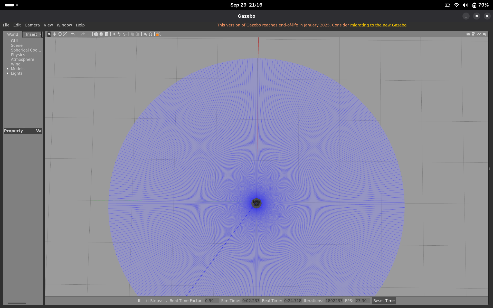
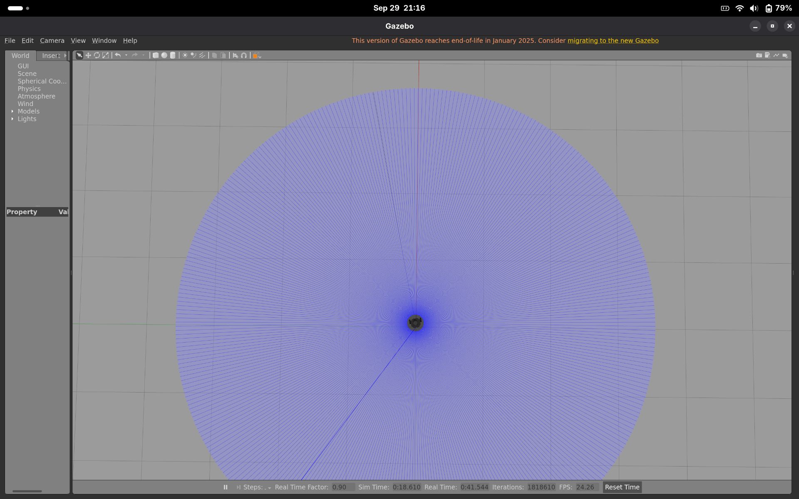
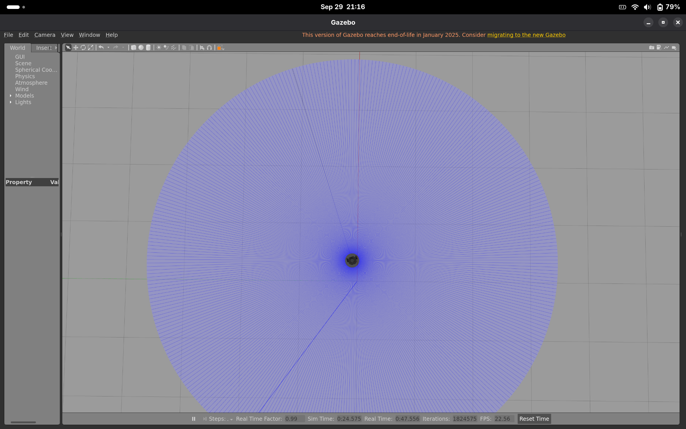
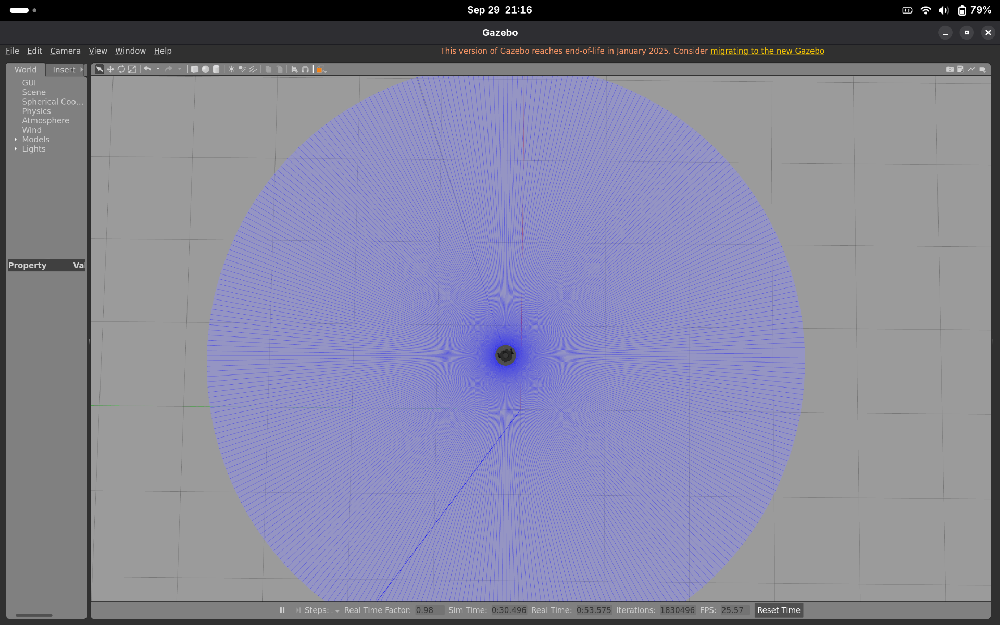
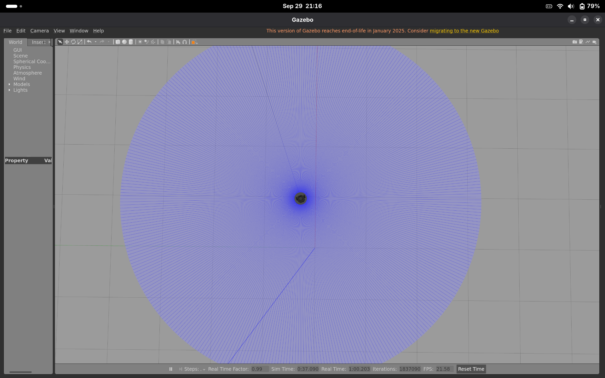
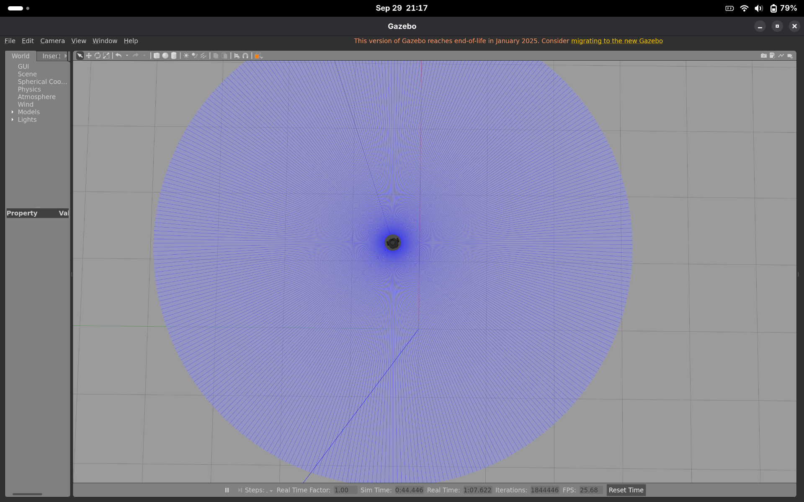
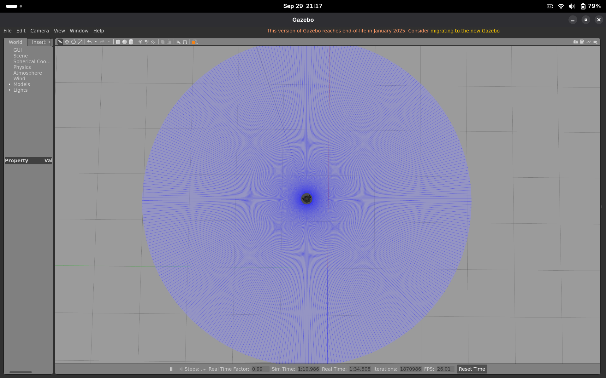

# Yıldız Rover Ödev-4: TurtleBot3 Hedef Noktaya Gitme

TurtleBot3 robotunu Gazebo simülasyonunda, başlangıç noktasıyla aynı doğrultuda olmayan bir hedef noktaya götüren ROS2 (Humble) Python node'u.

## Node Nasıl Çalışır?

`go_to_goal` node'u:

1. `/odom` topic'ine subscribe olarak robotun anlık konumunu (x, y) okur ve oryantasyonu quaternion'dan yaw açısına çevirir.
2. 0.1 saniyelik bir timer ile hedefe olan Öklid uzaklığını ve hedefe yönelme açısını (`atan2`) hesaplar. Açısal hata −π ile π arasına normalize edilir.
3. Oransal (P) kontrol ile doğrusal ve açısal hızı belirler. Açı hatası büyükse (> 0.5 rad) robot önce yerinde dönüp hedefe yönelir, ardından ilerler.
4. Hesaplanan hızı `geometry_msgs/msg/Twist` mesajı olarak `/cmd_vel` topic'ine publish eder.
5. Hedefe 0.1 m'den daha yakın olduğunda doğrusal ve açısal hızı sıfır olarak publish eder ve robot durur.

| Parametre | Değer |
|---|---|
| Hedef nokta (odom çerçevesi) | x = 1.6, y = 0.5 |
| Durma toleransı | 0.1 m |
| Maksimum doğrusal hız | 0.05 m/s |
| Doğrusal / açısal kazanç | 0.1 / 0.5 |

Hedef nokta ve kazançlar `rover_odev_pkg/go_to_goal.py` dosyasının başında değiştirilebilir. Hızlar, Gazebo'nun CPU ile render edildiği ortamlarda simülasyonun takılmaması için düşük tutulmuştur.

## Gereksinimler

- Ubuntu 22.04 veya `osrf/ros:humble-desktop` Docker/Podman imajı
- ROS2 Humble
- TurtleBot3 ve Gazebo paketleri:

```bash
sudo apt update
sudo apt install ros-humble-gazebo-ros-pkgs ros-humble-turtlebot3 ros-humble-turtlebot3-simulations
```

## Kurulum

```bash
mkdir -p ~/ros2_ws/src
cd ~/ros2_ws/src
git clone https://github.com/muhammeddurmaz254/rover-assignment-4.git rover_odev_pkg
cd ~/ros2_ws
source /opt/ros/humble/setup.bash
colcon build --packages-select rover_odev_pkg
```

## Çalıştırma

**1. Terminal: Gazebo ortamını başlatın**

```bash
source /opt/ros/humble/setup.bash
export TURTLEBOT3_MODEL=burger
ros2 launch turtlebot3_gazebo empty_world.launch.py
```

> Ödev engelsiz bir ortam istediği için `empty_world` kullanılmıştır. `turtlebot3_world` haritasında 9 silindir direk bulunur ve robot (−2.0, −0.5) noktasından başladığı için hedefe giderken (−1.1, 0) direğine çarpabilir.

**2. Terminal: Node'u çalıştırın**

```bash
source /opt/ros/humble/setup.bash
source ~/ros2_ws/install/setup.bash
ros2 run rover_odev_pkg go_to_goal
```

Robot hedefe ilerlerken terminalde kalan mesafe yazdırılır (`Hedefe gidiliyor... Mesafe: X.XX m`). Hedefe ulaşıldığında `Hedefe ulaşıldı! Hız sıfırlandı.` mesajı görülür ve robot durur.

Topic'leri izlemek için:

```bash
ros2 topic echo /cmd_vel
ros2 topic echo /odom
```

## Konteyner İçinde Çalıştırma (Podman/Docker)

Gazebo arayüzünün konteynerden açılabilmesi için X11 soketinin paylaşılması gerekir:

```bash
xhost +local:
podman run -it --name rover_odev --net=host --ipc=host \
  -e DISPLAY -e LIBGL_ALWAYS_SOFTWARE=1 \
  -v /tmp/.X11-unix:/tmp/.X11-unix:ro \
  docker.io/osrf/ros:humble-desktop
```

`LIBGL_ALWAYS_SOFTWARE=1` Gazebo'nun GPU yerine CPU ile render etmesini sağlar.

Açık bir konteynerde yeni terminal için: `podman exec -it rover_odev bash`

## Paket Yapısı

```
rover_odev_pkg/
├── package.xml
├── setup.py
├── setup.cfg
├── resource/rover_odev_pkg
├── rover_odev_pkg/
│   ├── __init__.py
│   └── go_to_goal.py
└── test/
```

## Görseller

Robotun `empty_world` ortamında (0, 0) noktasından (1.6, 0.5) hedefine hareketi (üstten görünüm):

| Başlangıç | Hareket 1 |
|---|---|
|  |  |

| Hareket 2 | Hareket 3 |
|---|---|
|  |  |

| Hareket 4 | Hareket 5 |
|---|---|
|  |  |

| Hedefe Varış |
|---|
|  |
